# 工廠管理軟體完整狀態機

本文件是目前實作的狀態模型。狀態與轉移直接對應 `src/`、`electron/`、`shared/` 中的程式碼；修改使用者流程、選取邏輯、存檔、維護或更新功能時，必須同步更新本文件與對應測試。

## 1. 建模方式

應用程式同時存在多個互相影響的正交狀態區域。任一時刻的完整狀態為：

```text
AppState =
  Process
  × Session
  × Persistence
  × View
  × Selection
  × Forms
  × Clipboard
  × Drag
  × MaintenanceUndo
  × Update
  × Notification
```

| 區域 | 主要狀態 |
| --- | --- |
| Process | 啟動、主實例、次實例、關閉確認、結束 |
| Session | 未選存檔、建立／開啟／讀取中、作用中、載入錯誤 |
| Persistence | 已儲存、草稿、儲存中、外部修改衝突、一般儲存錯誤 |
| View | 前台維護、後台管理 |
| Selection | 無產線、有效產線、無機台、有效機台 |
| Forms | 收合、新增、編輯、驗證錯誤、提交中 |
| Clipboard | 空、產線、機台、耗材 |
| Drag | 閒置、拖曳、跨產線移轉、儲存中 |
| MaintenanceUndo | 無、15 秒內可復原、復原中、逾時 |
| Update | idle、checking、current、available、downloading、ready、installing、error |
| Notification | 無、成功、錯誤、更新通知 |

## 2. 全域不變量

這些條件必須在每次狀態轉移後成立：

1. `dataPath` 為空時只能停留在未選存檔畫面；`dataPath` 有值時才能進入前台或後台。
2. `saving.current === true` 時不得開始第二次資料突變、切換存檔、切換前後台或重複安裝更新。
3. `selectedLineId` 必須是目前資料中的有效產線 ID，或在沒有產線時為 `undefined`。
4. `selectedMachineId` 必須屬於目前選中的產線，或在該產線沒有機台時為 `undefined`。
5. 顯示第一筆資料的 fallback 只負責初始解析，不能取代正式寫回選取 ID。
6. 刪除選中的產線或機台後，只有在存檔成功時才能寫入下一個有效選取 ID；存檔失敗時保留原選取與表單內容。
7. 切換產線會清除機台與耗材表單；切換機台會清除耗材表單。存在相關草稿時必須先取得使用者確認。
8. 新增產線後，只有在沒有機台／耗材草稿時才切到新產線；新增機台後，只有在沒有耗材草稿時才切到新機台。
9. 所有建立、編輯、刪除、排序、拖放、貼上、完成維護與復原操作，都先產生下一份資料，再經由同一個 `persist` 流程落盤。
10. `persist` 成功才套用伺服端回傳的 `data`、`dataPath` 與成功後選取動作；失敗保留輸入草稿。
11. IME 組字期間不得用 Enter 提交或開始資料突變；`compositionend` 或欄位失焦後解除組字狀態。
12. 有草稿或正在儲存時，關閉視窗必須進入離開確認；更新安裝期間若仍有未儲存內容，必須取消安裝並回到 ready。
13. 更新只有在 Windows x64 單檔可攜版、存在有效 release、下載完成且沒有草稿／儲存作業時才能安裝。
14. 維護復原只在完成後 15 秒內有效，而且只在該筆耗材的 `lastMaintainedAt` 仍等於本次完成時間時套用。
15. 第二個程式實例不得建立第二份寫入狀態；它只能喚醒並聚焦既有視窗。

## 3. 應用程式與存檔工作階段

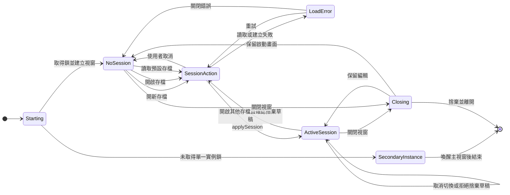

`applySession` 是完整重設邊界，會執行：

- 切回前台。
- 清空維護復原、拖曳、剪貼簿、表單與展開狀態。
- 將產線選取設為第一筆，機台選取設為該產線第一筆。
- 更新日期、存檔路徑與成功訊息。

## 4. 檔案載入、復原與儲存

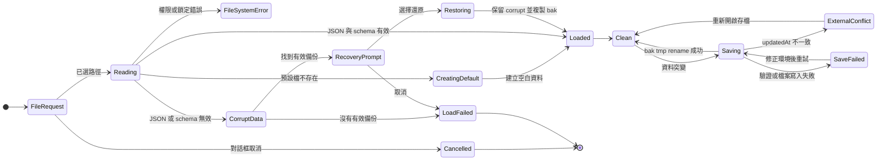

建立新存檔時，若目標已存在，先保存 `.replaced-時間.bak`；一般儲存先輪替 `.bak`，再寫入 `.tmp` 並 rename 到正式檔案。

## 5. 前後台與草稿

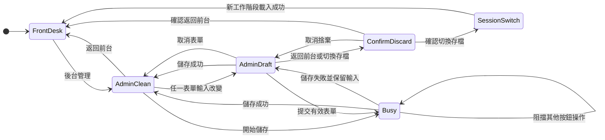

切換前後台會清除拖曳、維護復原、一般成功訊息與表單展開狀態。從後台返回前台時，草稿必須先取消或確認捨棄。

## 6. 階層選取狀態

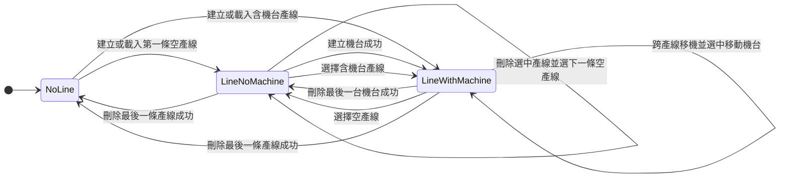

### 選取守衛與動作

| 事件 | 守衛 | 成功動作 | 拒絕時 |
| --- | --- | --- | --- |
| 選產線 | 非儲存中；機台／耗材草稿已確認捨棄 | 寫入產線 ID、該產線第一個機台 ID；清空下層表單 | 保留全部狀態 |
| 選機台 | 非儲存中；耗材草稿已確認捨棄 | 寫入機台 ID；清空耗材表單 | 保留全部狀態 |
| 刪除選中產線 | 使用者確認；存檔成功 | 寫入下一個有效產線與其第一個機台 ID | 存檔失敗時保留原狀態 |
| 刪除選中機台 | 使用者確認；存檔成功 | 寫入下一個有效機台 ID | 存檔失敗時保留原狀態 |
| 跨產線移機 | 草稿已確認捨棄；存檔成功 | 選中目的產線與被移動機台 | 取消或失敗時保留原選取 |

## 7. 表單生命週期

產線、機台、耗材共用同一個表單狀態形狀；差異列在後方矩陣。

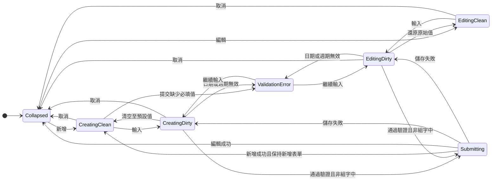

| 表單 | 顯示前提 | 建立成功後選取 | 額外驗證 |
| --- | --- | --- | --- |
| 產線 | 無產線時自動顯示，否則按新增 | 無下層草稿時選中新產線 | 名稱必填 |
| 機台 | 必須有選中產線；無機台時自動顯示 | 無耗材草稿時選中新機台 | 名稱必填 |
| 耗材 | 必須有選中機台；無耗材時自動顯示 | 保持目前機台 | 名稱必填、週期為正整數、日期有效、上次維護不晚於今天 |

IME 子狀態：

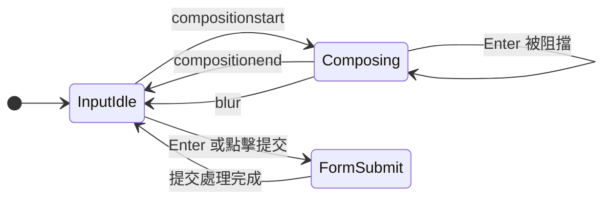

## 8. 資料突變、複製貼上與拖曳

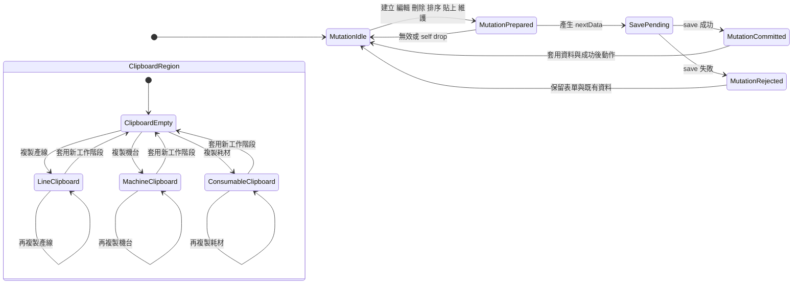

剪貼簿規則：

- 只有相同種類顯示貼上按鈕。
- 機台貼上要求有效產線；耗材貼上要求有效機台。
- 副本遞迴產生新 ID；耗材副本清除實際與預定維護日期。
- 貼上成功後保留來源剪貼簿，可重複貼上。

拖曳狀態：

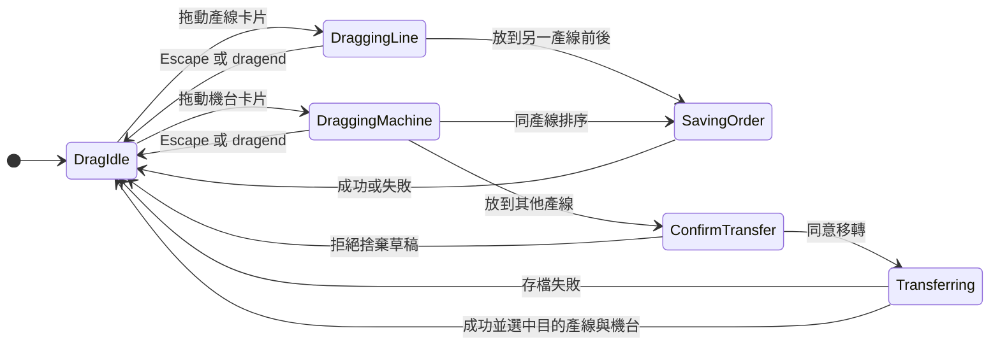

## 9. 前台維護與復原

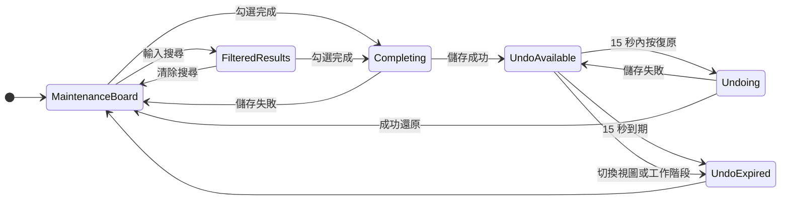

完成維護會寫入目前時間、清除預定維護日期並重新計算下次日期。復原只在目標耗材仍保有本次完成時間時生效，避免覆蓋後續維護紀錄。

## 10. 更新狀態機

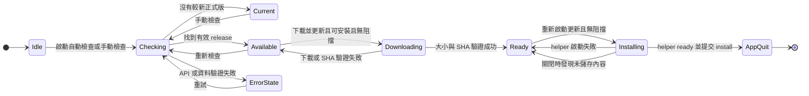

更新 UI 還有獨立的 popover 顯示狀態：按版本按鈕開關；新版或前次更新失敗通知會自動開啟；Escape 或點擊外部關閉。不可自動替換時，只能開啟 GitHub Release 頁面。

## 11. 通知與暫態 UI

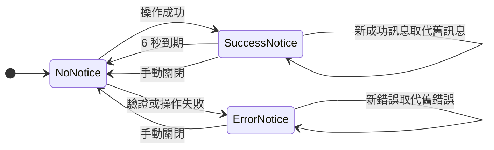

維護完成且存在復原項目時，復原面板取代一般成功訊息；錯誤訊息仍優先顯示。

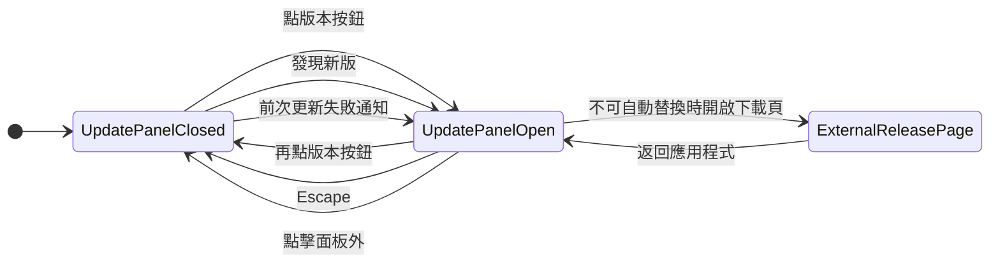

不改變工廠資料的本機 UI 操作：

- 日期欄位可直接輸入，或開啟原生日期選擇器回填文字欄位。
- 編輯選單提供復原、重做、剪下、複製、貼上與全選；可編輯欄位的右鍵選單依 Electron `editFlags` 決定可用項目。
- 非編輯文字選取的右鍵選單只提供複製。
- 檢視選單可放大、縮小、恢復原始大小及切換全螢幕。
- 檔案或連結拖進視窗不得導覽離開應用程式；網頁要求開新視窗一律拒絕。

## 12. 視窗與程式生命週期

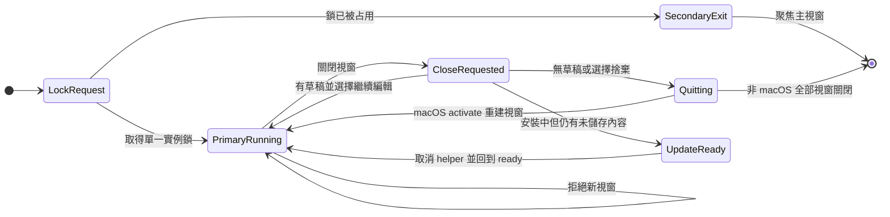

## 13. 完整操作矩陣

| 操作 | 起始區域 | 守衛／確認 | 成功結果 | 失敗／取消結果 |
| --- | --- | --- | --- | --- |
| 開新存檔 | NoSession 或 ActiveSession | 非儲存中；草稿需確認捨棄 | 建立空資料並 applySession | 保持原工作階段 |
| 開啟存檔 | NoSession 或 ActiveSession | 同上 | 驗證、必要時還原備份、applySession | 顯示載入錯誤 |
| 讀取預設存檔 | NoSession | 非儲存中 | 載入；不存在時建立 | 顯示載入錯誤 |
| 切換前後台 | ActiveSession | 非儲存中；後台草稿需確認 | 清理暫態狀態並切換 | 保留目前畫面 |
| 選產線 | Admin | 非儲存中；下層草稿需確認 | 更新產線與第一機台 ID | 保持選取 |
| 選機台 | Admin | 非儲存中；耗材草稿需確認 | 更新機台 ID | 保持選取 |
| 新增／編輯 | Admin | 前置選取有效、非組字中、驗證通過 | 統一 persist；成功後清理表單 | 保留草稿並顯示錯誤 |
| 刪除 | Admin | 使用者確認、非儲存中 | persist；必要時改選下一有效項目 | 保留資料與選取 |
| 上移／下移 | Admin | 目標索引有效、非儲存中 | persist 新順序，選取 ID 不變 | 保留舊順序 |
| 拖曳排序 | Admin | 合法 target、非儲存中 | persist 新順序 | self／無效 drop 不寫入 |
| 跨產線移機 | Admin | 草稿需確認 | persist；選中目的產線與移動機台 | 保留來源、選取與草稿 |
| 複製 | Admin | 無 | 寫入同種類剪貼簿 | 無 |
| 貼上 | Admin | 種類相符；父層選取有效 | 建立新 ID 副本並 persist | 按鈕隱藏或停用 |
| 完成維護 | Front 或 Admin | 非儲存中；編輯同耗材時需確認 | persist；前台建立 15 秒復原項 | 保留原紀錄 |
| 復原維護 | Front | 未逾時、紀錄時間仍相符 | persist 原維護日期並移除復原項 | 保留復原項或忽略 |
| 搜尋／清除搜尋 | Front | 無 | 切換完整清單與搜尋結果 | 無 |
| 檢查更新 | 任意畫面 | 更新器非 active、非 ready | current／available／error | 保持可重試 |
| 下載更新 | 任意畫面 | release 有效、Windows portable、無草稿／儲存 | ready | 清理 stage 並進入 error |
| 安裝更新 | 任意畫面 | ready、無草稿／儲存 | helper ready 後退出並替換 | 回到 ready |
| 開關更新面板 | 任意畫面 | 無 | 按鈕、Escape 或點擊外部切換顯示 | 無 |
| 開啟 Release 頁 | 更新面板 | 不支援自動替換 | 交給系統瀏覽器 | 顯示開啟失敗 |
| 關閉通知 | ActiveSession | 有成功或錯誤訊息 | 清空 message 與 error | 無 |
| 日期輸入／選擇 | Admin 表單 | 有效父層選取 | 更新表單草稿 | 提交時顯示日期錯誤 |
| 原生編輯指令 | 任意可編輯欄位 | Electron editFlags 允許 | 修改目前文字選取 | 指令停用 |
| 縮放／全螢幕 | 任意畫面 | 無 | 只改變視窗呈現 | 不改變應用狀態 |
| 關閉視窗 | 任意畫面 | 草稿／儲存時需確認 | 退出 | 繼續編輯 |
| 啟動第二實例 | Process | 單一實例鎖已占用 | 聚焦主視窗 | 第二實例退出 |

## 14. 測試對應

| 狀態區域 | 自動驗證 |
| --- | --- |
| Session、Persistence、Forms、Selection | `tests/App.test.tsx` |
| 檔案路徑、備份、外部修改、還原 | `tests/factoryData.test.ts` |
| 維護日期與狀態 | `tests/maintenance.test.ts` |
| 前台搜尋、完成、復原、焦點 | `tests/FrontDesk.test.tsx`、`scripts/front-desk-smoke.cjs` |
| 拖曳、跨產線移轉、刪除後選取 | `tests/items.test.ts`、`tests/dragPreview.test.ts`、`scripts/drag-smoke.cjs` |
| 更新選版、下載、UI、替換與回復 | `tests/updates.test.ts`、`tests/UpdateControl.test.tsx`、`scripts/update-helper-smoke.cjs`、`scripts/update-flow-smoke.cjs` |
| 完整桌面資料流程與版面 | `scripts/desktop-smoke.cjs`、`scripts/admin-layout-smoke.cjs` |

## 15. 修改狀態機的完成條件

任何新增或修改操作都必須完成以下項目：

1. 指出受影響的狀態區域、事件、守衛、成功動作與失敗動作。
2. 更新本文件中的狀態圖、不變量與操作矩陣。
3. 對中介狀態加斷言；不能只驗證最後畫面看起來正確。
4. 對刪除、移動、切換工作階段與儲存失敗，同時驗證資料與選取 ID。
5. 對跨區域操作至少執行一條真實 Electron smoke 流程。
6. 通過 `npm test`、`npm run build` 與相關 smoke script。

## 16. 實作來源

- `src/App.tsx`：工作階段、視圖、選取、表單、資料突變、維護與復原。
- `src/FrontDesk.tsx`：前台搜尋、工作清單、完成維護與焦點回復。
- `src/SelectableCard.tsx`、`shared/items.ts`：拖曳、排序與跨產線移轉。
- `src/UpdateControl.tsx`、`electron/updater.ts`、`shared/updates.ts`：更新 UI 與主程序狀態。
- `electron/main.ts`：單一實例、視窗、關閉確認、IPC 與存檔工作階段。
- `electron/factoryData.ts`：路徑解析、驗證、備份、還原與安全寫入。
- `shared/schema.ts`、`shared/maintenance.ts`：資料 schema 與維護日期規則。
