# 工廠管理軟體完整狀態機

本文件是目前實作的狀態模型。狀態與轉移直接對應 `src/`、`electron/`、`shared/` 中的程式碼；修改使用者流程、選取邏輯、存檔、維護或更新功能時，必須同步更新本文件與對應測試。

本文件同時是行為規格與驗證清單。每條轉移都必須能回答「來源狀態、事件、守衛、成功動作、失敗／取消動作」；程式碼若違反全域不變量，應修正程式碼，不得把 fallback 顯示或偶然重繪寫成合法狀態。尚未有自動測試的路徑必須在第 14 節明確標記，不得以鄰近函式測試代替。

代理執行整輪驗收時，必須使用 [state-machine-acceptance.md](state-machine-acceptance.md)。本文件定義行為；驗收文件定義實際操作、證據與通過門檻。

## 1. 建模方式

應用程式同時存在多個互相影響的正交狀態區域。任一時刻的完整狀態為：

```text
AppState =
  Process
  × Session
  × Persistence
  × View
  × Selection
  × Forms
  × Clipboard
  × Drag
  × MaintenanceUndo
  × Update
  × Notification
```

| 區域 | 主要狀態 |
| --- | --- |
| Process | 啟動、主實例、次實例、關閉確認、結束 |
| Session | 未選存檔、建立／開啟／讀取中、作用中、載入錯誤 |
| Persistence | 已儲存、草稿、儲存中、外部修改衝突、一般儲存錯誤 |
| View | 前台維護、後台管理 |
| Selection | 無產線、有效產線、無機台、有效機台 |
| Forms | 收合、新增、編輯、驗證錯誤、提交中 |
| Clipboard | 空、產線、機台、耗材 |
| Drag | 閒置、拖曳、跨產線移轉、儲存中 |
| MaintenanceUndo | 無、15 秒內可復原、復原中、逾時 |
| Update | idle、checking、current、available、downloading、ready、installing、error |
| Notification | 無、成功、錯誤、更新通知 |

## 2. 全域不變量

這些條件必須在每次狀態轉移後成立：

1. `dataPath` 為空時只能停留在未選存檔畫面；`dataPath` 有值時才能進入前台或後台。
2. `saving.current === true` 時不得開始第二次資料突變、切換存檔、切換前後台或重複安裝更新。
3. `selectedLineId` 必須是目前資料中的有效產線 ID，或在沒有產線時為 `undefined`。
4. `selectedMachineId` 必須屬於目前選中的產線，或在該產線沒有機台時為 `undefined`。
5. 顯示第一筆資料的 fallback 只負責初始解析，不能取代正式寫回選取 ID。
6. 刪除選中的產線或機台後，只有在存檔成功時才能寫入下一個有效選取 ID；存檔失敗時保留原選取與表單內容。
7. 切換產線會清除機台與耗材表單；切換機台會清除耗材表單。存在相關草稿時必須先取得使用者確認。
8. 新增產線後，只有在沒有機台／耗材草稿時才切到新產線；新增機台後，只有在沒有耗材草稿時才切到新機台。
9. 所有建立、編輯、刪除、排序、拖放、貼上、完成維護與復原操作，都先產生下一份資料，再經由同一個 `persist` 流程落盤。
10. `persist` 成功才套用伺服端回傳的 `data`、`dataPath` 與成功後選取動作；失敗保留輸入草稿。
11. IME 組字期間不得用 Enter 提交或開始資料突變；`compositionend` 或欄位失焦後解除組字狀態。
12. 有草稿或正在儲存時，關閉視窗必須進入離開確認；更新安裝期間若仍有未儲存內容，必須取消安裝並回到 ready。
13. 更新只有在 Windows x64 單檔可攜版、存在有效 release、下載完成且沒有草稿／儲存作業時才能安裝。
14. 維護復原只在完成後 15 秒內有效，而且只在該筆耗材的 `lastMaintainedAt` 仍等於本次完成時間時套用。
15. 第二個程式實例不得建立第二份寫入狀態；它只能喚醒並聚焦既有視窗。

## 3. 應用程式與存檔工作階段

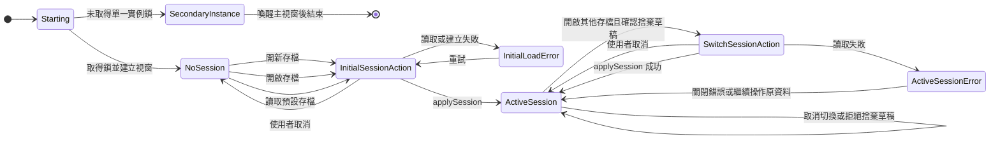

`applySession` 是完整重設邊界，會執行：

- 切回前台。
- 清空維護復原、拖曳、剪貼簿、表單與展開狀態。
- 將產線選取設為第一筆，機台選取設為該產線第一筆。
- 更新日期、存檔路徑與成功訊息。

作用中工作階段切換存檔失敗時，不會離開原工作階段：`data`、`dataPath`、選取與目前視圖保持不變，只更新錯誤訊息。

視窗關閉與程序結束屬於第 12 節的 Process 區域，不會被當成 Session 內部的資料轉移。

## 4. 檔案載入、復原與儲存

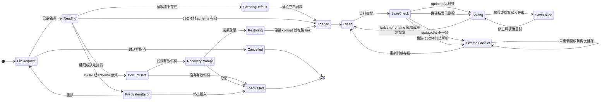

建立新存檔時，若目標已存在，先保存 `.replaced-時間.bak`；一般儲存先輪替 `.bak`，再寫入 `.tmp` 並 rename 到正式檔案。

`activeUpdatedAt` 只在載入或儲存成功後更新。外部修改或磁碟 JSON 損毀造成衝突時，它保持舊值；只要磁碟內容仍不符合該值，後續每次儲存都會再次進入 `ExternalConflict`。磁碟檔案被刪除時，`readUpdatedAt` 回傳 `undefined`，儲存流程會直接重建檔案。

## 5. 前後台與草稿

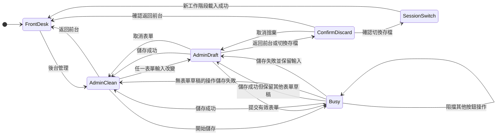

切換前後台會清除拖曳、維護復原、一般成功訊息與表單展開狀態。從後台返回前台時，草稿必須先取消或確認捨棄。

## 6. 階層選取狀態

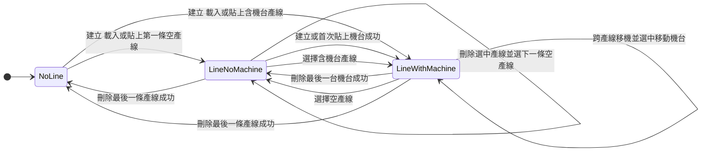

### 選取守衛與動作

| 事件 | 守衛 | 成功動作 | 拒絕時 |
| --- | --- | --- | --- |
| 選產線 | 非儲存中；機台／耗材草稿已確認捨棄 | 寫入產線 ID、該產線第一個機台 ID；清空下層表單 | 保留全部狀態 |
| 選機台 | 非儲存中；耗材草稿已確認捨棄 | 寫入機台 ID；清空耗材表單 | 保留全部狀態 |
| 刪除選中產線 | 使用者確認；存檔成功 | 寫入下一個有效產線與其第一個機台 ID | 存檔失敗時保留原狀態 |
| 刪除選中機台 | 使用者確認；存檔成功 | 寫入下一個有效機台 ID | 存檔失敗時保留原狀態 |
| 首次貼上產線 | 目前沒有產線；存檔成功 | 寫入新產線與其第一個機台 ID | 存檔失敗時保持無選取 |
| 空產線首次貼上機台 | 目前沒有機台；存檔成功 | 寫入新機台 ID | 存檔失敗時保持無機台選取 |
| 跨產線移機 | 有機台或耗材草稿時已確認捨棄；存檔成功 | 選中目的產線與被移動機台 | 取消或失敗時保留原選取 |

## 7. 表單生命週期

產線、機台、耗材共用同一個表單狀態形狀；差異列在後方矩陣。表單是否顯示由四個條件取聯集：使用者曾按「新增」、正在編輯、存在草稿、目前清單為空。

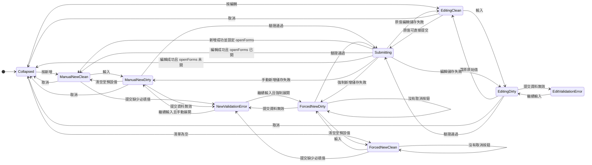

| 表單 | 顯示條件 | 取消按鈕條件 | 建立成功後選取 | 額外驗證 |
| --- | --- | --- | --- | --- |
| 產線 | `openForms.line`、`lineForm.id`、產線草稿或沒有產線 | 編輯中或 `openForms.line` | 無下層草稿時選中新產線 | 名稱必填 |
| 機台 | 有選中產線，且 `openForms.machine`、`machineForm.id`、機台草稿或該產線沒有機台 | 編輯中或 `openForms.machine` | 無耗材草稿時選中新機台 | 名稱必填 |
| 耗材 | 有選中機台，且 `openForms.consumable`、`consumableForm.id`、耗材草稿或該機台沒有耗材 | 編輯中或 `openForms.consumable` | 保持目前機台 | 名稱必填、週期為正整數、日期有效、上次維護不晚於今天 |

「清單為空」或「存在草稿」造成的強制展開不會自行提供取消按鈕。使用者曾按過新增時，`openForms` 會保持為 true；因此在同一表單後續完成編輯，成功後會回到空白新增表單，而不是收合。

IME 子狀態：

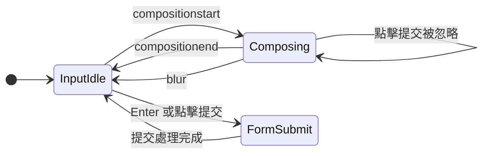

## 8. 資料突變、複製貼上與拖曳

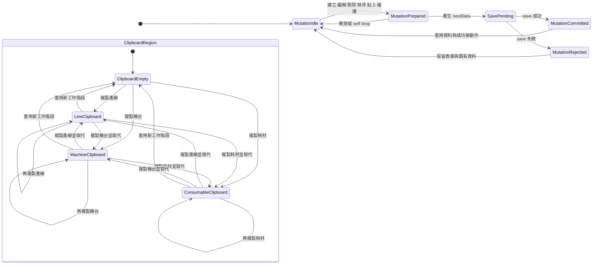

剪貼簿規則：

- 只有相同種類顯示貼上按鈕。
- 剪貼簿只有一格；複製任何其他種類會直接取代原內容。
- 機台貼上要求有效產線；耗材貼上要求有效機台。
- 副本遞迴產生新 ID；耗材副本清除實際與預定維護日期。
- 貼上成功後保留來源剪貼簿，可重複貼上。
- 沒有產線時首次貼上產線，成功後寫入新產線與其第一個機台 ID；空產線首次貼上機台，成功後寫入新機台 ID。

拖曳狀態：

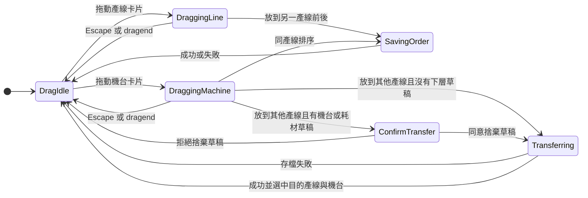

## 9. 前台維護與復原

前台預設清單依 `daysRemaining` 分區；搜尋模式則查詢所有耗材，不受預設分區可見性限制。

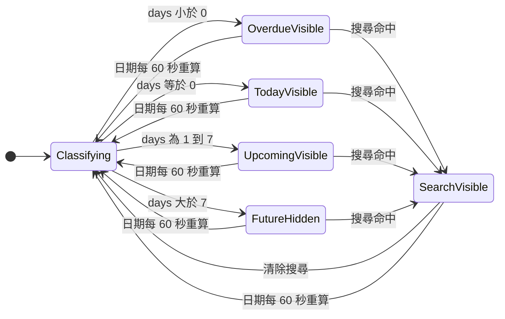

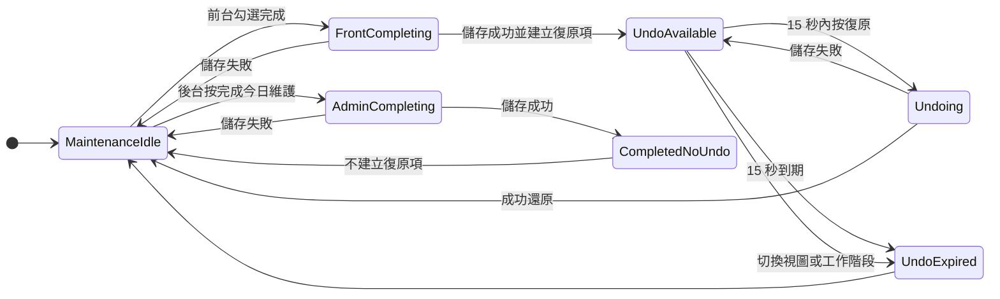

完成維護會寫入目前時間、清除預定維護日期並重新計算下次日期。`lastMaintainedAt` 是今天且下次維護日在今天之後時，勾選框進入「今日已完成」並停用。只有從前台完成維護才建立 15 秒復原項；後台的「完成今日維護」不建立復原項。復原只在目標耗材仍保有本次完成時間時生效，避免覆蓋後續維護紀錄。

應用程式每 60 秒重新計算本地日期；跨日時 `today` 改變，所有項目會依新的 `daysRemaining` 自動重新分類，今日完成狀態也會同步重算。

前台勾選完成後，原勾選框若因重新分類而離開 DOM，焦點移到下一個可用勾選框、前一個可用勾選框或搜尋欄；儲存失敗時原項目與焦點仍可重試。

## 10. 更新狀態機

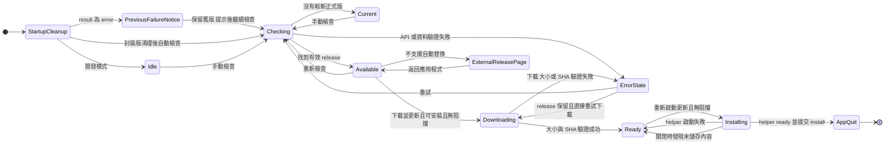

下載錯誤只把 `status` 改成 `error`，不清除 `release`；因此 UI 仍顯示新版與「下載並更新」，使用者可直接重新下載。`canInstall === false` 時不進入下載／安裝，改由系統瀏覽器開啟 GitHub Release。

啟動清理規則：

- 只在有 Windows portable target 時掃描同目錄的 `.factory-update-*`。
- `result.json.status === error` 時保留舊版並送出一次更新失敗通知。
- 沒有 `previous.exe`，或結果為 installed 且版本等於目前版本時，刪除該更新資料夾。
- 清理完成後，所有封裝版都執行正式版檢查；非 Windows portable 仍可看到新版，但只能開啟下載頁。

PowerShell 替換 helper 是獨立的持久狀態機：

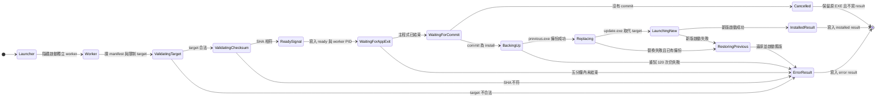

helper 在替換前最多以 500 ms 間隔重試 120 次移動原 EXE。替換或啟動新版失敗且已建立備份時，會移除失敗 target、還原 `previous.exe`、啟動舊版，再把錯誤寫入 `result.json`。驗證失敗發生在備份前時，原 EXE 保持不變並直接寫入錯誤結果。

更新 UI 還有獨立的 popover 顯示狀態：按版本按鈕開關；新版或前次更新失敗通知會自動開啟；Escape 或點擊外部關閉。

## 11. 通知與暫態 UI

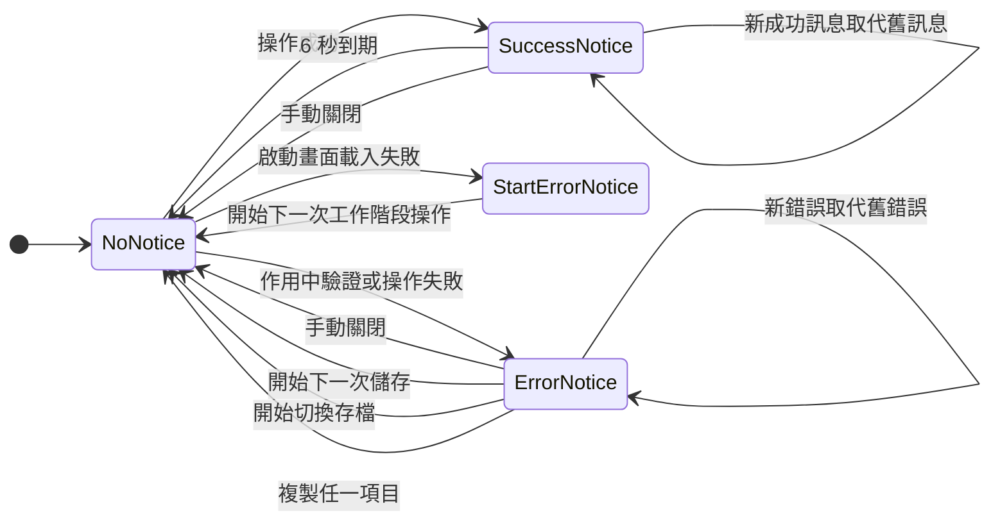

維護完成且存在復原項目時，復原面板取代一般成功訊息；錯誤訊息仍優先顯示。

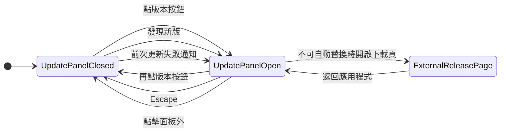

不改變工廠資料的本機 UI 操作：

- 日期欄位可直接輸入，或開啟原生日期選擇器回填文字欄位。
- 編輯選單提供復原、重做、剪下、複製、貼上與全選；可編輯欄位的右鍵選單依 Electron `editFlags` 決定可用項目。
- 非編輯文字選取的右鍵選單只提供複製。
- 檢視選單可放大、縮小、恢復原始大小及切換全螢幕。
- 檔案或連結拖進視窗不得導覽離開應用程式；網頁要求開新視窗一律拒絕。

## 12. 視窗與程式生命週期

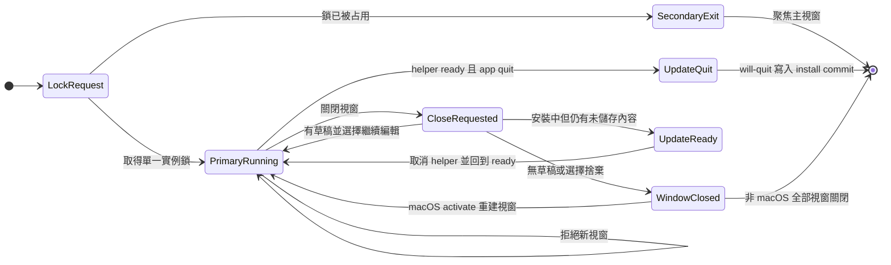

## 13. 完整操作矩陣

| 操作 | 起始區域 | 守衛／確認 | 成功結果 | 失敗／取消結果 |
| --- | --- | --- | --- | --- |
| 開新存檔 | NoSession | 非儲存中 | 建立空資料並 applySession | 使用者取消或顯示建立錯誤 |
| 開啟存檔 | NoSession 或 ActiveSession | 非儲存中；作用中有草稿時需確認捨棄 | 驗證、必要時還原備份、applySession | 啟動畫面保持 NoSession；作用中時保留原工作階段並顯示錯誤 |
| 讀取預設存檔 | NoSession | 非儲存中 | 載入；不存在時建立 | 顯示載入錯誤 |
| 還原損毀存檔 | 載入中 | 內容損毀、存在有效 bak、使用者同意 | 保留 corrupt 原檔、複製 bak 並 applySession | 取消或沒有備份時顯示載入錯誤 |
| 儲存資料 | ActiveSession | 非儲存中；磁碟 updatedAt 相符或檔案不存在 | bak、tmp、rename；更新 activeUpdatedAt | 外部衝突持續拒絕到重新開啟；一般 I/O 錯誤保留草稿 |
| 切換前後台 | ActiveSession | 非儲存中；後台草稿需確認 | 清理暫態狀態並切換 | 保留目前畫面 |
| 選產線 | Admin | 非儲存中；下層草稿需確認 | 更新產線與第一機台 ID | 保持選取 |
| 選機台 | Admin | 非儲存中；耗材草稿需確認 | 更新機台 ID | 保持選取 |
| 展開／取消表單 | Admin | 父層選取有效 | 手動展開可取消；編輯可取消 | 清單為空或只有草稿造成的強制展開不提供取消 |
| 新增／編輯 | Admin | 前置選取有效、非組字中、驗證通過；編輯原值也可提交 | 統一 persist；新增後保持新增表單；編輯後依 openForms 收合或回新增表單 | 保留草稿並顯示錯誤 |
| 刪除 | Admin | 使用者確認、非儲存中 | persist；必要時改選下一有效項目 | 保留資料與選取 |
| 上移／下移 | Admin | 目標索引有效、非儲存中 | persist 新順序，選取 ID 不變 | 保留舊順序 |
| 拖曳排序 | Admin | 合法 target、非儲存中 | persist 新順序 | self／無效 drop 不寫入 |
| 跨產線移機 | Admin | 只有存在機台或耗材草稿時才確認 | persist；選中目的產線與移動機台 | 拒絕確認時保留來源、選取與草稿 |
| 複製 | Admin | 無 | 取代單格剪貼簿內容並清除錯誤 | 無 |
| 貼上 | Admin | 種類相符；機台／耗材要求父層選取有效 | 建立新 ID 副本並 persist；首次產線／機台貼上寫回正式選取 ID | 按鈕隱藏或停用；儲存失敗不改選取 |
| 完成維護 | Front 或 Admin | 非儲存中；編輯同耗材時需確認 | persist；只有前台建立 15 秒復原項 | 保留原紀錄 |
| 復原維護 | Front | 未逾時、紀錄時間仍相符 | persist 原維護日期並移除復原項 | 保留復原項或忽略 |
| 搜尋／清除搜尋 | Front | 無 | 搜尋涵蓋全部耗材；預設只顯示逾期、今天與 7 天內 | 無 |
| 日期每分鐘更新 | Front 或 Admin | 定時器存活 | 跨日時重算分區、到期數與今日完成狀態 | 同一天字串不變時 React 保持現狀 |
| 啟動清理更新資料夾 | Process | Windows portable target 存在 | 刪除完成 stage；失敗結果送出提示 | 單一資料夾讀取／刪除錯誤被忽略並繼續 |
| 檢查更新 | 任意畫面 | 更新器非 active、非 ready | current／available／error | 保持可重試 |
| 下載更新 | 任意畫面 | release 有效、Windows portable、無草稿／儲存 | ready | 清理 stage 並進入 error；保留 release 供直接重試 |
| 安裝更新 | 任意畫面 | ready、無草稿／儲存 | helper ready 後退出並替換 | 回到 ready |
| helper 替換 EXE | Process | target 合法、SHA 相符、主程式已退出、commit 存在 | 備份、替換、啟動新版並寫 installed result | 無 commit 時取消；失敗時回滾舊版並寫 error result |
| 開關更新面板 | 任意畫面 | 無 | 按鈕、Escape 或點擊外部切換顯示 | 無 |
| 開啟 Release 頁 | 更新面板 | 不支援自動替換 | 交給系統瀏覽器 | 顯示開啟失敗 |
| 關閉／清除通知 | ActiveSession | 有成功或錯誤訊息 | 手動關閉；錯誤也會在儲存、切換存檔或複製開始時清除 | 新操作失敗時以新錯誤取代 |
| 日期輸入／選擇 | Admin 表單 | 有效父層選取 | 更新表單草稿 | 提交時顯示日期錯誤 |
| 原生編輯指令 | 任意可編輯欄位 | Electron editFlags 允許 | 修改目前文字選取 | 指令停用 |
| 縮放／全螢幕 | 任意畫面 | 無 | 只改變視窗呈現 | 不改變應用狀態 |
| 關閉視窗 | 任意畫面 | 草稿／儲存時需確認 | 退出 | 繼續編輯 |
| 啟動第二實例 | Process | 單一實例鎖已占用 | 聚焦主視窗 | 第二實例退出 |

## 14. 測試對應與覆蓋缺口

| 狀態區域 | 自動驗證 | 覆蓋狀態 |
| --- | --- | --- |
| Renderer Session、Forms、Selection、Clipboard、Persistence 協調 | `tests/App.test.tsx` | 已覆蓋作用中切檔失敗、跨種類剪貼簿、草稿與貼上／刪除選取路徑 |
| 檔案路徑、安全寫入、備份、重複外部衝突、損毀衝突、刪除後重建、還原函式 | `tests/factoryData.test.ts` | 函式層已覆蓋；不包含主程序還原對話框 |
| 維護日期與狀態計算 | `tests/maintenance.test.ts` | 已覆蓋 |
| 前台搜尋、分類、完成、復原、焦點 | `tests/FrontDesk.test.tsx`、`scripts/front-desk-smoke.cjs` | 已覆蓋主要流程 |
| 拖曳、跨產線移轉、刪除後選取 | `tests/items.test.ts`、`tests/dragPreview.test.ts`、`scripts/drag-smoke.cjs` | 已覆蓋 |
| 更新選版、下載、錯誤後直接重試、非 portable 分支、UI、helper 替換與回滾 | `tests/updates.test.ts`、`tests/UpdateControl.test.tsx`、`scripts/update-helper-smoke.cjs`、`scripts/update-flow-smoke.cjs` | 已覆蓋主要流程；啟動清理未覆蓋 |
| 完整桌面資料流程與版面 | `scripts/desktop-smoke.cjs`、`scripts/admin-layout-smoke.cjs` | 已覆蓋 |
| Electron 程式生命週期與啟動清理 | 無 | 未覆蓋下列四項 |

### 已知自動測試缺口

- [ ] 單一實例鎖：第二實例必須聚焦主視窗並自行退出。
- [ ] 導覽防護：拖入檔案或連結觸發 `will-navigate` 時必須阻止頁面離開，`window.open` 必須被拒絕。
- [ ] 損毀存檔協調：`main.ts` 的 `loadWithRecovery` 必須顯示還原對話框、依使用者選擇還原或取消，並更新作用中工作階段。
- [ ] 更新啟動清理：完成的 stage 必須刪除；失敗的 stage 必須送出一次提示並依 `previous.exe` 狀態保留或清理。

`tests/factoryData.test.ts` 只驗證備份讀取與 `restoreFactoryDataBackup` 函式，不驗證 Electron 對話框、取消分支或 `useSession` 協調。以上四項在補上測試前不得標記為已自動驗證。

## 15. 修改狀態機的完成條件

任何新增或修改操作都必須完成以下項目：

1. 指出受影響的狀態區域、事件、守衛、成功動作與失敗動作。
2. 更新本文件中的狀態圖、不變量與操作矩陣。
3. 對中介狀態加斷言；不能只驗證最後畫面看起來正確。
4. 對刪除、移動、切換工作階段與儲存失敗，同時驗證資料與選取 ID。
5. 對跨區域操作至少執行一條真實 Electron smoke 流程。
6. 每個狀態與守衛都能指向第 16 節的一個實作來源；推測行為不得寫成既定轉移。
7. 每個操作都列入第 13 節，並在第 14 節標示自動測試證據或明確缺口。
8. 同一事件在圖、不變量、操作矩陣與測試對應中的成功／失敗去向必須一致。
9. 所有 Mermaid 區塊通過結構檢查：`stateDiagram-v2`、至少一條 `-->`、無不支援的 note 或 style 語法。
10. 通過 `npm test`、`npm run build` 與相關 smoke script。

## 16. 實作來源

| 規格節 | 實作來源與主要符號 |
| --- | --- |
| 第 3 節 Session | `src/App.tsx`: `applySession`、`runSessionAction`; `electron/main.ts`: `useSession` 與 `factory-data:*` IPC |
| 第 4 節 File | `electron/main.ts`: `loadWithRecovery`; `electron/factoryData.ts`: `loadFactoryData`、`saveFactoryData`、`restoreFactoryDataBackup`、`createFactoryDataSession` |
| 第 5 節 View／Persistence | `src/App.tsx`: `switchView`、`persist`、`updateData`、`hasDraft` |
| 第 6 節 Selection | `src/App.tsx`: `findSelectedLine`、`findSelectedMachine`、`selectLine`、`selectMachine`、`deleteLine`、`deleteMachine`、`paste`、`handleDrop` |
| 第 7 節 Forms／IME | `src/App.tsx`: `lineForm`、`machineForm`、`consumableForm`、`openForms`、三個 `submit*`、workspace composition handlers |
| 第 8 節 Mutation／Clipboard／Drag | `src/App.tsx`: `move`、`paste`、`itemTools`、`handleDrop`; `src/SelectableCard.tsx`; `shared/items.ts`: `copyItem`、`moveItem`、`dropCard` |
| 第 9 節 Maintenance | `src/App.tsx`: `completeMaintenance`、`undoMaintenance`; `src/FrontDesk.tsx`; `shared/maintenance.ts` |
| 第 10 節 Update | `src/UpdateControl.tsx`; `electron/updater.ts`: `setupUpdater`; `electron/updateFiles.ts`; `shared/updates.ts`; `assets/update-portable.ps1` |
| 第 11 節 Notification | `src/App.tsx`: `message`、`error` 與清理動作; `src/UpdateControl.tsx`: `open`、`error`、`reveal` |
| 第 12 節 Process／Window | `electron/main.ts`: 單一實例事件、`createWindow`、`will-prevent-unload`、`window-all-closed`、`activate` |
| 資料合法性 | `shared/schema.ts`: Zod schemas; `shared/maintenance.ts`: 日期解析與維護週期 |
